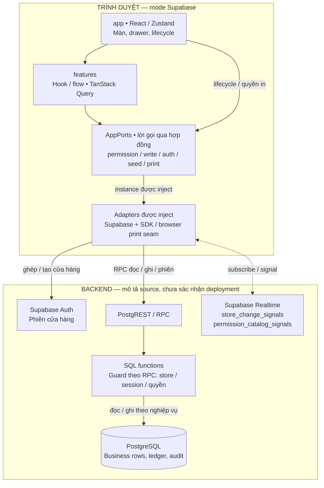
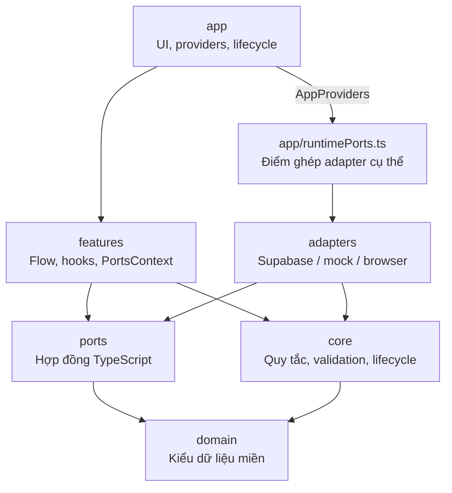

# Hai góc nhìn kiến trúc hiện hành

Ngày đối chiếu: **26/10/2026**, code đã tích hợp **`main@711a22e71983e3d6aa17799649af05ce4c762555`** (nguồn O). A01 mô tả lời gọi khi chọn mode Supabase; A02 mô tả phụ thuộc module. Hai loại mũi tên trả lời hai câu hỏi khác nhau. Đọc cùng [kiến trúc và lý do lựa chọn](architecture.md), [mô hình dữ liệu](data-model.md), [tám luồng chi tiết](critical-flows.md) và [bộ SVG](figures/README.md).

**Phạm vi bằng chứng:** hình được rút từ code/SQL của O, không phải ảnh chụp deployment. Metadata staging S đã được kiểm ở [N1](implementation-log/staging-schema-20261026/README.md) và [N2](implementation-log/critical-flows-20261026/README.md). [Review ngữ nghĩa](reviews/diagram-semantics-20261026/INDEX.md) phân biệt S (`ineckiashpwloncxnbqx`) với DB L trong cấu hình frontend local (`kfqjdfwxhkdwihjobpny`); L và bản Vercel chưa được xác minh trong hồ sơ đó. Task này không truy vấn lại hoặc sửa DB, không nhận metadata là kết quả kiểm chạy.

## A01 — Lời gọi và ranh giới thực thi

[Mở SVG](figures/2026-10-26-architecture/architecture-01.svg) · [Nguồn Mermaid](figures/2026-10-26-architecture/architecture-01.mmd).

**Cách đọc:** nét liền là chiều gọi, phản hồi đi ngược đường gọi và được lược bỏ; nét đứt hai chiều là đăng ký subscription và nhận signal, không cam kết giao nhận hay thứ tự. Callback từ adapter về app được giải thích trong bảng, không vẽ đường vòng ngược lên UI. `AppPorts` là hợp đồng TypeScript và các instance được truyền qua context, không phải một server, queue hoặc lớp proxy mạng. Khung backend nhóm dịch vụ, không khẳng định có một tiến trình server duy nhất. Đây là đường POS/identity rút gọn; đường ảnh món, in và mock được ghi riêng bên dưới.

| Điểm trên hình | Trách nhiệm và nguồn đã đọc |
| --- | --- |
| UI → features → AppPorts | Query theo purpose đi qua `usePermissionPorts`; query key, điều kiện enabled và hàm đọc dùng authority hiện hành. [usePosData.ts:8](https://github.com/nguyentronglinh045/pos-cafe/blob/711a22e71983e3d6aa17799649af05ce4c762555/src/features/pos/usePosData.ts#L8), [portsContext.tsx:4](https://github.com/nguyentronglinh045/pos-cafe/blob/711a22e71983e3d6aa17799649af05ce4c762555/src/features/shared/portsContext.tsx#L4). Không khẳng định mọi lời gọi đều qua feature hook: lifecycle ở app và quyền in còn dùng port trực tiếp. [PermissionLifecycle.tsx:23](https://github.com/nguyentronglinh045/pos-cafe/blob/711a22e71983e3d6aa17799649af05ce4c762555/src/app/PermissionLifecycle.tsx#L23), [ReceiptPreview.tsx:288](https://github.com/nguyentronglinh045/pos-cafe/blob/711a22e71983e3d6aa17799649af05ce4c762555/src/app/components/ReceiptPreview.tsx#L288). |
| AppPorts → adapter cụ thể | `AppProviders` tạo ports rồi inject qua context; `runtimePorts` chọn mock hoặc Supabase từ env. Nhánh Supabase gọi factory hiện hành, gồm permission runtime và write repo ở chế độ candidate. [AppProviders.tsx:37](https://github.com/nguyentronglinh045/pos-cafe/blob/711a22e71983e3d6aa17799649af05ce4c762555/src/app/AppProviders.tsx#L37), [runtimePorts.ts:16](https://github.com/nguyentronglinh045/pos-cafe/blob/711a22e71983e3d6aa17799649af05ce4c762555/src/app/runtimePorts.ts#L16), [repos.ts:17](https://github.com/nguyentronglinh045/pos-cafe/blob/711a22e71983e3d6aa17799649af05ce4c762555/src/adapters/supabase/repos.ts#L17), [newPermissionRuntime.ts:16](https://github.com/nguyentronglinh045/pos-cafe/blob/711a22e71983e3d6aa17799649af05ce4c762555/src/adapters/supabase/newPermissionRuntime.ts#L16). |
| Store Auth và phiên nhân viên | Ghép cửa hàng dùng Store Key để đăng nhập Auth; đăng nhập nhân viên gọi RPC bằng employee ID/PIN, nhận token giữ trong adapter. Đây là hai danh tính có vai trò khác nhau, không phải tài khoản Auth riêng cho từng nhân viên. [authRepo.ts:34](https://github.com/nguyentronglinh045/pos-cafe/blob/711a22e71983e3d6aa17799649af05ce4c762555/src/adapters/supabase/authRepo.ts#L34), [permissionIdentityRepo.ts:35](https://github.com/nguyentronglinh045/pos-cafe/blob/711a22e71983e3d6aa17799649af05ce4c762555/src/adapters/supabase/permissionIdentityRepo.ts#L35). Không suy đây là hoàn tất mục tiêu tài khoản chủ cửa hàng/email/recovery. |
| Adapter → RPC | Client gắn contract header cho PostgREST của project và employee token khi có; read adapter chụp generation/token, gọi RPC, kiểm generation và giải mã DTO trước khi trả dữ liệu. [client.ts:15](https://github.com/nguyentronglinh045/pos-cafe/blob/711a22e71983e3d6aa17799649af05ce4c762555/src/adapters/supabase/client.ts#L15), [client.ts:39](https://github.com/nguyentronglinh045/pos-cafe/blob/711a22e71983e3d6aa17799649af05ce4c762555/src/adapters/supabase/client.ts#L39), [permissionReadRepo.ts:260](https://github.com/nguyentronglinh045/pos-cafe/blob/711a22e71983e3d6aa17799649af05ce4c762555/src/adapters/supabase/permissionReadRepo.ts#L260). |
| SQL là nơi thực thi quyền và giao dịch | Guard phụ thuộc endpoint: RPC vận hành kiểm `auth.uid()`, phiên nhân viên và quyền phù hợp; bootstrap/login/PIN có hợp đồng riêng. Ví dụ đọc floor kiểm employee + `floor.view` và lọc store; tài chính kiểm quyền lại sau vùng chờ khóa. [permission-identity.sql:159](https://github.com/nguyentronglinh045/pos-cafe/blob/711a22e71983e3d6aa17799649af05ce4c762555/supabase/candidate/permission-identity.sql#L159), [permission-read.sql:180](https://github.com/nguyentronglinh045/pos-cafe/blob/711a22e71983e3d6aa17799649af05ce4c762555/supabase/candidate/permission-read.sql#L180), [permission-financial.sql:33](https://github.com/nguyentronglinh045/pos-cafe/blob/711a22e71983e3d6aa17799649af05ce4c762555/supabase/candidate/permission-financial.sql#L33). Register và execute là hai transaction riêng; xem [F02](critical-flows.md#f02), không gom toàn bộ A01 thành một transaction. |
| Realtime → callback → đọc lại | Adapter subscribe đúng hai bảng tín hiệu trên hình. Callback tại app lifecycle invalidate query hoặc yêu cầu làm mới authority; dữ liệu nghiệp vụ được đọc lại qua port/RPC. [permissionSignalPort.ts:51](https://github.com/nguyentronglinh045/pos-cafe/blob/711a22e71983e3d6aa17799649af05ce4c762555/src/adapters/supabase/permissionSignalPort.ts#L51), [PermissionLifecycle.tsx:67](https://github.com/nguyentronglinh045/pos-cafe/blob/711a22e71983e3d6aa17799649af05ce4c762555/src/app/PermissionLifecycle.tsx#L67). A01 lược bỏ đường tạo signal trong SQL và chi tiết subscription/callback; [F08](critical-flows.md#f08) giữ chi tiết, giới hạn poll và khoảng thiếu tín hiệu liên kết món–nhóm tùy chọn. |

**Ranh giới kiểm quyền:** UI che/chặn thao tác và bỏ response cũ để bảo vệ trạng thái hiển thị. Quyền ở DB còn phụ thuộc grants, RLS và guard của từng function; không dùng việc UI ẩn nút làm bằng chứng chống truy cập trực tiếp. RPC `SECURITY DEFINER` trong candidate tự kiểm tenant/employee/permission; không mô tả RLS là cơ chế duy nhất tự kiểm mọi lời gọi. Recipe O thu hồi quyền trực tiếp trên bảng/cột nghiệp vụ tại [permission-read.sql:357](https://github.com/nguyentronglinh045/pos-cafe/blob/711a22e71983e3d6aa17799649af05ce4c762555/supabase/candidate/permission-read.sql#L357). Source candidate không tự chứng minh recipe đã activate trên mọi DB đích; đối chiếu triển khai vẫn theo [data model](data-model.md).

| Đường rút gọn ngoài A01 | Hiện trạng |
| --- | --- |
| Ảnh món | Permission image adapter gọi Edge Function `menu-image-gateway` để stage/read/discard; gateway gọi RPC kiểm quyền và thao tác Storage ở phía server. Không vẽ thành browser ghi thẳng bucket bằng quyền quản trị. [permissionMenuImagePort.ts:57](https://github.com/nguyentronglinh045/pos-cafe/blob/711a22e71983e3d6aa17799649af05ce4c762555/src/adapters/supabase/permissionMenuImagePort.ts#L57), [gateway:53](https://github.com/nguyentronglinh045/pos-cafe/blob/711a22e71983e3d6aa17799649af05ce4c762555/supabase/functions/menu-image-gateway/index.ts#L53). Đây là đoạn staging, không phải mô tả đủ finalize/public delivery. |
| In | Với hóa đơn, UI gọi permission print để xin quyền mỗi click rồi dùng cơ chế in trình duyệt; biến thể phiếu khác xác minh quyền hiện hành qua authority. `AppPorts.print` là seam browser no-op, không gửi RPC hoặc lệnh máy in vật lý; A01 chỉ vẽ các kết nối backend của phần Supabase trong nhóm adapter. [ReceiptPreview.tsx:288](https://github.com/nguyentronglinh045/pos-cafe/blob/711a22e71983e3d6aa17799649af05ce4c762555/src/app/components/ReceiptPreview.tsx#L288), [browser/printPort.ts:1](https://github.com/nguyentronglinh045/pos-cafe/blob/711a22e71983e3d6aa17799649af05ce4c762555/src/adapters/browser/printPort.ts#L1). |
| Mock | Cùng composition root có nhánh `createMockPermissionRuntime`; mock là lựa chọn khác của AppPorts, không là dịch vụ backend chạy song song Supabase. [runtimePorts.ts:37](https://github.com/nguyentronglinh045/pos-cafe/blob/711a22e71983e3d6aa17799649af05ce4c762555/src/app/runtimePorts.ts#L37). Factory `createSupabaseLegacyPorts` là đường test tương thích tách riêng, không phải factory UI đang chọn. [repos.ts:30](https://github.com/nguyentronglinh045/pos-cafe/blob/711a22e71983e3d6aa17799649af05ce4c762555/src/adapters/supabase/repos.ts#L30). |

## A02 — Phụ thuộc module và điểm ghép adapter

[Mở SVG](figures/2026-10-26-architecture/architecture-02.svg) · [Nguồn Mermaid](figures/2026-10-26-architecture/architecture-02.mmd).

**Mỗi mũi tên A → B nghĩa là module A import/re-export hoặc tham chiếu kiểu từ B**, không phải thứ tự chạy hoặc chiều phản hồi. Đây là các cạnh chính để đọc ranh giới, không phải đồ thị đầy đủ mọi import. Cụ thể app còn import core/domain/ports; features và adapters còn import domain; composition còn import ports và state phiên trong features. Những cạnh rút gọn đó không bị cấm. Nguồn ví dụ: [PermissionLifecycle.tsx:1](https://github.com/nguyentronglinh045/pos-cafe/blob/711a22e71983e3d6aa17799649af05ce4c762555/src/app/PermissionLifecycle.tsx#L1), [runtimePorts.ts:1](https://github.com/nguyentronglinh045/pos-cafe/blob/711a22e71983e3d6aa17799649af05ce4c762555/src/app/runtimePorts.ts#L1), [orderFlow.ts:1](https://github.com/nguyentronglinh045/pos-cafe/blob/711a22e71983e3d6aa17799649af05ce4c762555/src/features/pos/orderFlow.ts#L1), [permissionReadRepo.ts:1](https://github.com/nguyentronglinh045/pos-cafe/blob/711a22e71983e3d6aa17799649af05ce4c762555/src/adapters/supabase/permissionReadRepo.ts#L1).

Các ranh giới dưới đây áp dụng mã ứng dụng (production source); file test có thể import chéo để dựng fixture. Guard dùng [productionImports:118](https://github.com/nguyentronglinh045/pos-cafe/blob/711a22e71983e3d6aa17799649af05ce4c762555/src/architectureBoundaries.test.ts#L118) để loại file test khỏi phép kiểm này.

| Ranh giới | Đọc đúng theo source |
| --- | --- |
| `domain` | Import nội bộ cùng domain. |
| `core` | Import core/domain, không import ports; lifecycle nhận callback getRevision/getAuthority từ bên ngoài và có timer, nên không gọi toàn bộ core là hàm thuần. [permissionLifecycle.ts:1](https://github.com/nguyentronglinh045/pos-cafe/blob/711a22e71983e3d6aa17799649af05ce4c762555/src/core/permissionLifecycle.ts#L1). |
| `ports` | Import ports/domain; adapter phụ thuộc hợp đồng này, hợp đồng không import adapter. [permissions.ts:1](https://github.com/nguyentronglinh045/pos-cafe/blob/711a22e71983e3d6aa17799649af05ce4c762555/src/ports/permissions.ts#L1). |
| `features` | Không import app/adapters; **vẫn có React, Zustand và TanStack Query**. Không gọi toàn bộ features là use case thuần hoặc hoàn toàn độc lập UI framework. [portsContext.tsx:1](https://github.com/nguyentronglinh045/pos-cafe/blob/711a22e71983e3d6aa17799649af05ce4c762555/src/features/shared/portsContext.tsx#L1), [usePosData.ts:1](https://github.com/nguyentronglinh045/pos-cafe/blob/711a22e71983e3d6aa17799649af05ce4c762555/src/features/pos/usePosData.ts#L1), [permissionSession.ts:1](https://github.com/nguyentronglinh045/pos-cafe/blob/711a22e71983e3d6aa17799649af05ce4c762555/src/features/shared/permissionSession.ts#L1). |
| `adapters` và composition | Adapter không import app/features. Trong app, chỉ runtimePorts được import adapter cụ thể; factory Supabase/mock tự ghép các thành phần của nó. [repos.ts:17](https://github.com/nguyentronglinh045/pos-cafe/blob/711a22e71983e3d6aa17799649af05ce4c762555/src/adapters/supabase/repos.ts#L17). |

Các quy tắc import trên được mô tả trong [boundary guard:123](https://github.com/nguyentronglinh045/pos-cafe/blob/711a22e71983e3d6aa17799649af05ce4c762555/src/architectureBoundaries.test.ts#L123). Lượt này đối chiếu source để vẽ hình, không chạy lại suite boundary và không nhận tồn tại test là PASS mới. Phân tách giúp thay adapter và kiểm logic theo seam; chưa chứng minh đổi DB/UI framework không tốn công. Nghiệp vụ giao dịch còn nằm trong SQL, nên không mô tả hệ thống là một domain core TypeScript chứa toàn bộ quy tắc. Lý do và đánh đổi giữ ở [hồ sơ kiến trúc](architecture.md#hexagonal-architecture--ports--adapters), cơ sở học thuật ở [C01–C03](references.md#claims).

## Giới hạn, kiểm hình và dùng làm báo cáo

- Nguồn O khác snapshot WIP. **FIN-WIP-02 còn mở**: khoảng chờ authority trước begin chưa được bảo vệ tương đương O; ACL recipe của W cũng khác O. [Hồ sơ khác biệt](reviews/diagram-semantics-20261026/INDEX.md#wip) giữ bằng chứng. A01/A02 không chứng minh W đã sửa hoặc backend đã nghiệm thu.
- [Manifest](figures/2026-10-26-architecture/manifest.json) ghim code ref, blob/hash Markdown, khối Mermaid, SVG và renderer. [Handoff](workflow/tasks/docs-architecture-overview-2026-10-26.md) ghi kiểm và review riêng của hai hình mới; không mượn verdict của bộ ERD/flow trước.
- Đây là hình kỹ thuật để AI/người viết truy nguồn. Khi đưa vào báo cáo, chuyển nhãn đường dẫn/symbol thành vai trò thiết kế theo [report source map](report-source-map.md); chưa nhận bộ hình có nhãn nội bộ này là bản dàn trang nộp trường.
- HTML kiến trúc cũ, Word/PDF/in, mẫu trường, kiểm chạy đa thiết bị và deployment không được xác minh bằng lượt xuất SVG này. Giữ các gate và checklist tương ứng mở.
