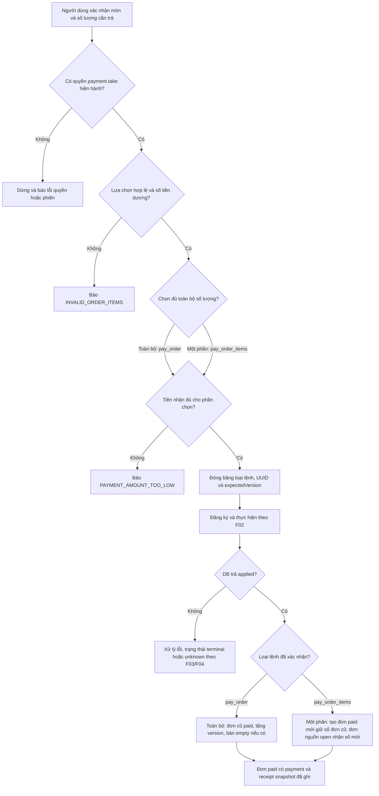
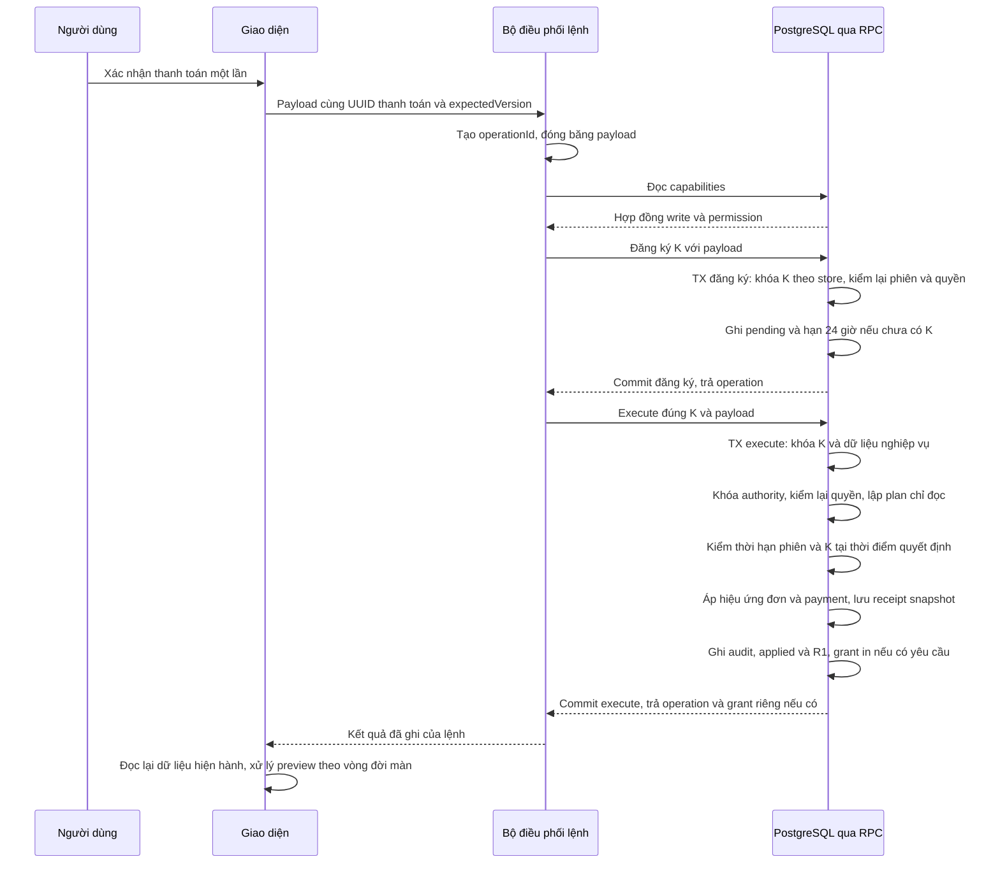
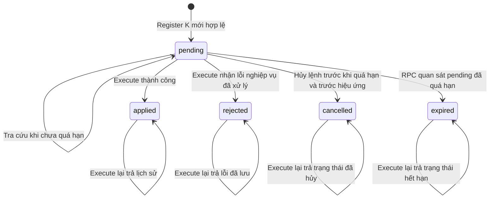
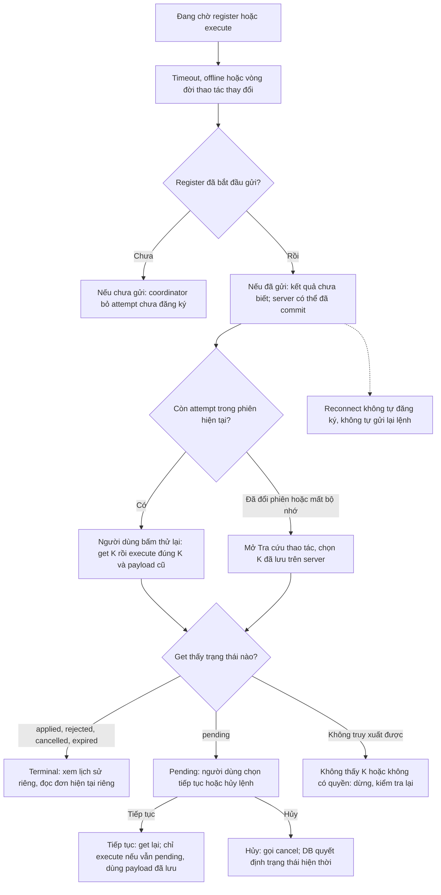
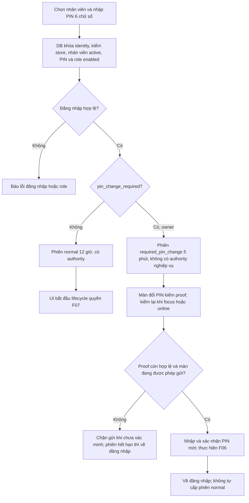
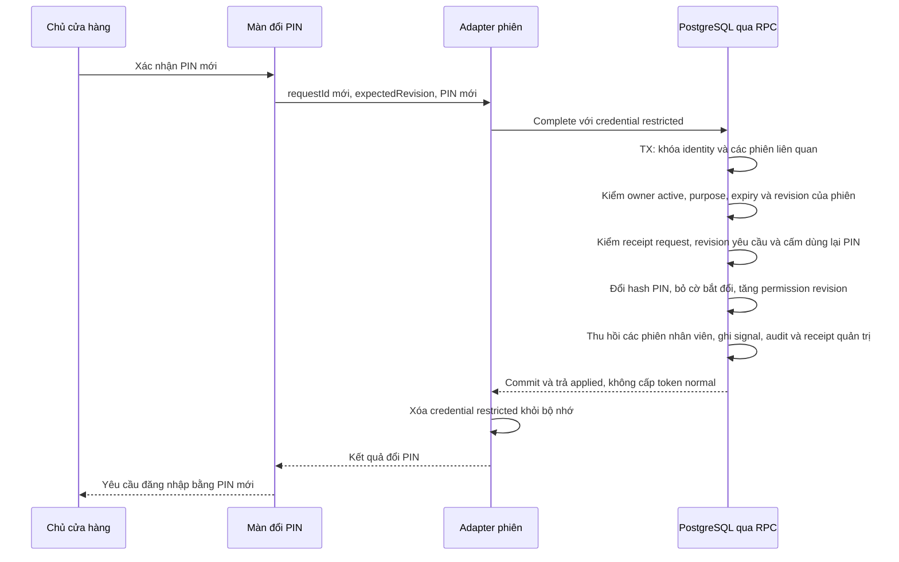
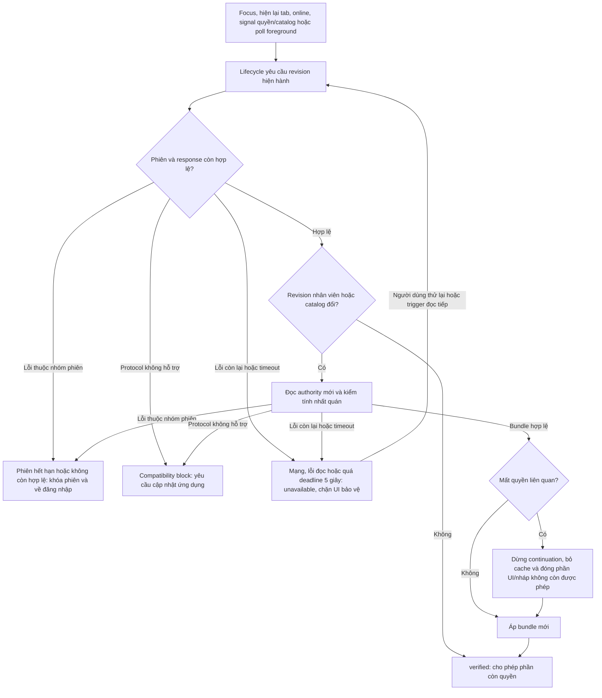
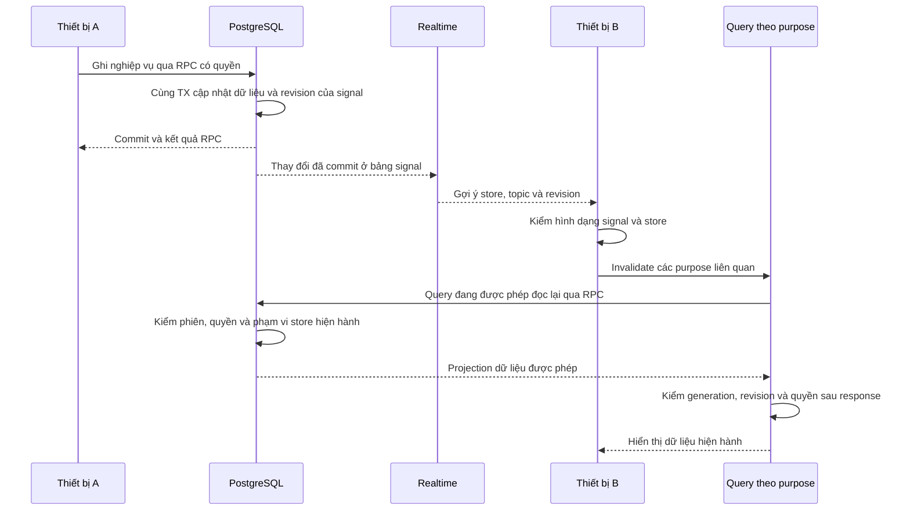

# Các luồng quan trọng của POS Cafe

[Bản SVG đã render và kiểm hình — 26/10/2026](figures/README.md): 8 ERD + 8 luồng, giữ nguyên Mermaid và phạm vi nguồn; chưa phải hình dàn trang theo mẫu báo cáo.

Đối chiếu ngày **26/10/2026**, code `main@711a22e71983e3d6aa17799649af05ce4c762555`, DB staging `ineckiashpwloncxnbqx`. Đây là bản mô tả implementation để tra cứu và làm đầu vào báo cáo; không thêm requirement hoặc đề xuất refactor.

**Trạng thái của cả tám hình:** luồng hiện hành trong source đã ghim, có đối chiếu metadata staging. [Evidence N2](implementation-log/critical-flows-20261026/README.md) xác nhận fingerprint body của **28 function/overload được chọn**, publication và trigger tín hiệu; [evidence N1](implementation-log/staging-schema-20261026/README.md) giữ đối chiếu bảng/cột/khóa. Đây không là kiểm chạy giao dịch, trình duyệt hoặc giao nhận realtime; backend acceptance vẫn HOLD. Mỗi hình dưới ghi phạm vi DB cụ thể; không suy mọi dependency/function đều đã đối chiếu.

| Nhóm | Hình và câu hỏi |
| --- | --- |
| Thanh toán và tách đơn | [F01](#f01) — chọn toàn bộ/một phần tạo kết quả nào? [F02](#f02) — phần nào cùng transaction? |
| Chống trùng và khôi phục | [F03](#f03) — trạng thái lệnh trên DB; [F04](#f04) — xử lý khi không biết kết quả |
| Phiên, PIN và quyền | [F05](#f05) — đăng nhập thường/đổi PIN bắt buộc; [F06](#f06) — transaction đổi PIN; [F07](#f07) — làm mới và thu hồi quyền |
| Đồng bộ giữa thiết bị | [F08](#f08) — signal → invalidation → đọc lại có quyền |

Ký hiệu: **K = (storeId, operationId)** là định danh lệnh; **payload** là ý định bất biến; **R1** là BusinessResult đã lưu khi lệnh applied lần đầu. `rejected` lưu lỗi riêng, không phải R1 thành công. Xem [thuật ngữ](glossary.md), [mô hình](data-model.md), [kiến trúc](architecture.md). Đường gọi adapter/RPC được rút gọn trong hình; bảng nguồn chỉ rõ nơi thực hiện.

## F01 — Chọn phần thanh toán và kết quả tách đơn

Ngày26/10/2026 — implementation hiện hành. DB đã đối chiếu body planner/apply và dispatcher tài chính; chưa chạy payment/split thực tế trong lượt này. Tiền mặt là đường đang dùng. Đơn phải là đơn đang mở; `expectedVersion` được đóng băng cùng lựa chọn để DB kiểm lại.

[Mở SVG của hình này](figures/2026-10-26/flow-01.svg)

Hai nút kết quả payment/receipt trong hình là **mô tả hiệu ứng cùng transaction DB**, không là lời gọi ghi tiếp từ UI sau khi nhận applied. Với tách đơn, dòng chọn đủ số lượng chuyển nguyên ID sang đơn paid; dòng chọn một phần giữ phần còn lại ở đơn nguồn và tạo dòng mới bằng splitItemId, sao chép snapshot giá/tùy chọn. Đơn nguồn giữ ID, giảm tổng, tăng version và vẫn giữ bàn; đơn paid mới cũng lưu tableId để truy vết nhưng không làm trống bàn. Số mới của đơn nguồn lấy số tiếp theo của ngày nghiệp vụ cũ, không lấy ngày hiện tại của thiết bị.

Ví dụ minh họa thuật toán, không phải dữ liệu staging: đơn #12 có hai cà phê 30.000đ và một trà 20.000đ. Trả riêng một cà phê tạo đơn paid #12 giá30.000đ; đơn nguồn còn50.000đ, nhận số tiếp theo (giả sử #13) và vẫn mở. Đây là tách thành hai đơn, không giữ một đơn với nhiều khoản trả một phần.

Nguồn: [chọn toàn bộ/một phần](https://github.com/nguyentronglinh045/pos-cafe/blob/711a22e71983e3d6aa17799649af05ce4c762555/src/features/pos/orderFlow.ts#L358), [thanh toán toàn bộ](https://github.com/nguyentronglinh045/pos-cafe/blob/711a22e71983e3d6aa17799649af05ce4c762555/src/features/pos/orderFlow.ts#L274), [kiểm version/trạng thái](https://github.com/nguyentronglinh045/pos-cafe/blob/711a22e71983e3d6aa17799649af05ce4c762555/supabase/migrations/015_write_business_helpers.sql#L117), [tính tiền từ snapshot](https://github.com/nguyentronglinh045/pos-cafe/blob/711a22e71983e3d6aa17799649af05ce4c762555/supabase/migrations/015_write_business_helpers.sql#L208), [hiệu ứng tách và payment](https://github.com/nguyentronglinh045/pos-cafe/blob/711a22e71983e3d6aa17799649af05ce4c762555/supabase/migrations/015_write_business_helpers.sql#L276).

## F02 — Đăng ký K và thực hiện giao dịch tài chính

Ngày26/10/2026 — implementation hiện hành; DB fingerprint khớp các entry point tài chính, dispatcher, checkpoint, planner/apply được liệt kê trong evidence. Hình là đường thành công khi K mới/pending. **Register và execute là hai RPC, hai transaction riêng**; ký hiệu bắt đầu/commit dưới đây diễn tả ranh giới RPC, không phải UI gửi lệnh BEGIN/COMMIT.

[Mở SVG của hình này](figures/2026-10-26/flow-02.svg)

Đường đi chưa thành công không được suy từ hình happy path:

| Điểm chặn | Kết quả implementation |
| --- | --- |
| Sai capability/protocol | Client dừng; production adapter yêu cầu writeProtocolVersion1 và permissionContractVersion2. Không fallback sang raw repository. |
| K có payload khác | `IDEMPOTENCY_KEY_REUSED`; không thay payload đã đăng ký. |
| Không thấy K khi execute/get/cancel | `OPERATION_NOT_FOUND`; các RPC này không đăng ký hộ. |
| Phiên/quyền không hợp lệ | Từ chối trước hiệu ứng; nhánh terminal cũng kiểm quyền hiện hành trước trả lịch sử. |
| K đã terminal | Execute trả operation lịch sử và tăng replayCount; không chạy lại planner/hiệu ứng. Không tạo lại initial print grant từ replay. |
| K pending đã quá expiresAt | Ghi expired; không ghi payment. Hạn K là24giờ kể từ đăng ký, khác hạn đơn hoặc phiên. |
| Sai expectedVersion, lựa chọn, tiền nhận hoặc lỗi nghiệp vụ đã nhận diện | Ghi rejected/error. Phần apply/audit/R1/grant nằm trong subtransaction; nếu lỗi được bắt tại đây, hiệu ứng của subtransaction rollback trước khi lưu rejected bên ngoài nó. |
| Lỗi SQL ngoài các nhánh đã bắt | RPC lỗi/rollback; không mặc định có rejected receipt. Client phải xử lý tình trạng chưa biết nếu không nhận kết quả. |

Khóa dữ liệu có thể chờ được lấy trước checkpoint authority/final clock. Kiểm quyền ở UI chỉ hỗ trợ tương tác; DB kiểm lại quyền sau vùng chờ. Giá và options để thanh toán lấy từ snapshot của đơn đã lưu; không tự thay giá đơn cũ bằng menu mới.

In nằm sau thanh toán và có cổng riêng: grant in ban đầu có thể được tạo cùng execute nhưng nằm ngoài payload/R1; mỗi click in kiểm quyền qua RPC trước khi dispatch trình duyệt. Mất/không in được không đảo payment. Không nhận “đã gửi lệnh in” là giấy đã in, và recovery không tự in lại.

Nguồn: [coordinator](https://github.com/nguyentronglinh045/pos-cafe/blob/711a22e71983e3d6aa17799649af05ce4c762555/src/features/pos/writeOperationFlow.ts#L72), [capability và adapter](https://github.com/nguyentronglinh045/pos-cafe/blob/711a22e71983e3d6aa17799649af05ce4c762555/src/adapters/supabase/writeOperationRepo.ts#L13), [register](https://github.com/nguyentronglinh045/pos-cafe/blob/711a22e71983e3d6aa17799649af05ce4c762555/supabase/candidate/permission-financial.sql#L33), [dispatcher và subtransaction](https://github.com/nguyentronglinh045/pos-cafe/blob/711a22e71983e3d6aa17799649af05ce4c762555/supabase/candidate/permission-financial.sql#L61), [khóa input](https://github.com/nguyentronglinh045/pos-cafe/blob/711a22e71983e3d6aa17799649af05ce4c762555/supabase/migrations/015_write_business_helpers.sql#L66), [cổng mỗi click in](https://github.com/nguyentronglinh045/pos-cafe/blob/711a22e71983e3d6aa17799649af05ce4c762555/src/app/components/ReceiptPreview.tsx#L279).

## F03 — Trạng thái bền vững của lệnh trên DB

Ngày26/10/2026 — implementation hiện hành; đối chiếu body register/dispatcher/list trên staging. **Unknown không phải trạng thái DB**; nó là tình trạng nhận thức của client khi thiếu phản hồi. Các cạnh dưới chỉ có hiệu lực sau kiểm phiên/quyền/input tương ứng.

[Mở SVG của hình này](figures/2026-10-26/flow-03.svg)

ExpiresAt được xét khi request phù hợp chạm lệnh; list cũng cập nhật các pending quá hạn thuộc phạm vi quyền của người gọi. Hình không hàm ý có cron tự chạy đúng giây hết hạn. Get có thể materialize expiry, nên “tra cứu” ở đây là RPC ứng dụng có thể cập nhật ledger, khác các SELECT catalog chỉ đọc mà lượt docs đã dùng.

Lỗi quyền/input/payload mismatch không tự biến pending thành rejected. Cancel không hủy payment đã applied; hủy đơn đã thanh toán là nghiệp vụ `void_order` khác. R1 không được dùng để ghi đè trạng thái đơn hiện tại: đơn có thể đã thay đổi sau thời điểm lệnh thành công.

Nguồn: [terminal replay](https://github.com/nguyentronglinh045/pos-cafe/blob/711a22e71983e3d6aa17799649af05ce4c762555/supabase/candidate/permission-financial.sql#L79), [expiry/cancel/apply/reject](https://github.com/nguyentronglinh045/pos-cafe/blob/711a22e71983e3d6aa17799649af05ce4c762555/supabase/candidate/permission-financial.sql#L108), [list và expiry](https://github.com/nguyentronglinh045/pos-cafe/blob/711a22e71983e3d6aa17799649af05ce4c762555/supabase/candidate/permission-financial.sql#L179), [diễn giải terminal result](https://github.com/nguyentronglinh045/pos-cafe/blob/711a22e71983e3d6aa17799649af05ce4c762555/src/features/pos/writeOperationFlow.ts#L167).

## F04 — Mất phản hồi, thử lại và tra cứu khôi phục

Ngày26/10/2026 — implementation hiện hành ở client, kết hợp các RPC tài chính đã fingerprint. Chưa chạy mất mạng/timeout/race trong lượt docs.

[Mở SVG của hình này](figures/2026-10-26/flow-04.svg)

`retryCurrent` luôn get rồi execute cùng payload đang giữ, kể cả get thấy terminal: nhánh replay ở DB ngăn lặp hiệu ứng. `resume` từ màn tra cứu khác ở chỗ get lại và chỉ execute nếu còn pending. Một phản hồi pending hoặc lỗi tiếp tục giữ tình trạng chưa xác định để người dùng tra cứu; không tự dựng lựa chọn mới, register K bị thiếu hoặc mở preview in.

Coordinator chỉ ở bộ nhớ. Timeout mặc định15giây không hủy request server. Đóng drawer/đổi context làm phản hồi cũ mất hiệu lực với UI; đổi nhân viên/phiên xóa ngữ cảnh client tương ứng, không hủy transaction đang chạy trên server. Thu hồi quyền có thể chặn cả xem/tiếp tục lệnh cũ. Tạo ý định mới sau terminal bị từ chối/hủy/hết hạn cần đọc dữ liệu hiện hành và xác nhận mới, không sửa payload của K cũ.

Nguồn: [attempt trong bộ nhớ, timeout](https://github.com/nguyentronglinh045/pos-cafe/blob/711a22e71983e3d6aa17799649af05ce4c762555/src/features/pos/writeOperationFlow.ts#L27), [retryCurrent và resume](https://github.com/nguyentronglinh045/pos-cafe/blob/711a22e71983e3d6aa17799649af05ce4c762555/src/features/pos/writeOperationFlow.ts#L104), [đổi vòng đời/phiên](https://github.com/nguyentronglinh045/pos-cafe/blob/711a22e71983e3d6aa17799649af05ce4c762555/src/app/WriteLifecycle.tsx#L20), [tra cứu và đọc đơn hiện tại](https://github.com/nguyentronglinh045/pos-cafe/blob/711a22e71983e3d6aa17799649af05ce4c762555/src/app/drawers/pos/WriteRecoveryDrawer.tsx#L77), [action không retry tự động hoặc mở receipt](https://github.com/nguyentronglinh045/pos-cafe/blob/711a22e71983e3d6aa17799649af05ce4c762555/src/app/drawers/pos/WriteRecoveryDrawer.tsx#L95).

## F05 — Đăng nhập nhân viên và phiên đổi PIN bắt buộc

Ngày26/10/2026 — implementation hiện hành; DB fingerprint khớp start_session, current_employee và required-PIN RPC. Tiền điều kiện: đã có phiên cửa hàng. Danh tính cửa hàng và phiên nhân viên là hai lớp; hình không mô tả owner email/recovery/ownership transfer chưa hoàn thiện.

[Mở SVG của hình này](figures/2026-10-26/flow-05.svg)

Hình rút gọn nhánh kết thúc thành công; lỗi PIN mới trùng PIN tạm hoặc input không hợp lệ giữ màn để sửa. Lỗi phiên/revision hoặc kết quả đổi PIN không rõ đưa về đăng nhập. Khi lost-ACK, UI hướng dẫn thử PIN mới; nếu chưa được thì thử PIN tạm. Không replay request hoàn tất bằng credential đã bị thu hồi để lấy lại authority.

Token nhân viên giữ riêng trong adapter, memory-only; UI nhận view không có credential. DB lưu token hash. Phiên restricted chỉ phục vụ đổi PIN/proof; normal guard từ chối nó với `PIN_CHANGE_REQUIRED`. Hai TTL là thời hạn phiên do DB cấp, không phải TTL24giờ của lệnh tài chính.

Nguồn: [kiểm input và gọi session port](https://github.com/nguyentronglinh045/pos-cafe/blob/711a22e71983e3d6aa17799649af05ce4c762555/src/features/session/sessionFlow.ts#L70), [adapter giữ credential](https://github.com/nguyentronglinh045/pos-cafe/blob/711a22e71983e3d6aa17799649af05ce4c762555/src/adapters/supabase/permissionIdentityRepo.ts#L35), [cấp hai loại phiên](https://github.com/nguyentronglinh045/pos-cafe/blob/711a22e71983e3d6aa17799649af05ce4c762555/supabase/candidate/permission-identity.sql#L226), [normal guard](https://github.com/nguyentronglinh045/pos-cafe/blob/711a22e71983e3d6aa17799649af05ce4c762555/supabase/candidate/permission-identity.sql#L159), [proof/vòng đời](https://github.com/nguyentronglinh045/pos-cafe/blob/711a22e71983e3d6aa17799649af05ce4c762555/src/app/screens/RequiredPinChangeScreen.tsx#L74), [thành công và lỗi](https://github.com/nguyentronglinh045/pos-cafe/blob/711a22e71983e3d6aa17799649af05ce4c762555/src/app/screens/RequiredPinChangeScreen.tsx#L111).

## F06 — Hoàn tất đổi PIN bắt buộc trong một transaction

Ngày26/10/2026 — implementation hiện hành; body RPC complete_required_pin_change khớp staging. Hình là đường applied; không gửi PIN/token thật trong evidence.

[Mở SVG của hình này](figures/2026-10-26/flow-06.svg)

Các hiệu ứng PIN/revision/revocation/signal/audit/receipt cùng transaction của một RPC. Request receipt lưu MAC, không ghi PIN thô vào receipt. Việc kiểm tính hợp lệ của phiên đứng **trước** tra cứu receipt: sau thành công, credential restricted đã bị thu hồi nên không thể replay nó thành một phiên normal. `expectedRevision` lệch hoặc PIN mới trùng tạo kết quả denied/audit theo các nhánh tương ứng; lỗi format/phiên bị từ chối trước phần đó.

Nếu mất phản hồi sau commit, client chưa biết PIN đã đổi; việc quay về đăng nhập không rollback DB. Nếu nhận kết quả muộn sau đổi màn/phiên, guard client không cho response cũ mở lại quyền. Không áp cơ chế tự retry tài chính F04 cho request đổi PIN này.

Nguồn: [RPC và kiểm trước receipt](https://github.com/nguyentronglinh045/pos-cafe/blob/711a22e71983e3d6aa17799649af05ce4c762555/supabase/candidate/permission-identity.sql#L330), [denied/applied và các hiệu ứng](https://github.com/nguyentronglinh045/pos-cafe/blob/711a22e71983e3d6aa17799649af05ce4c762555/supabase/candidate/permission-identity.sql#L365), [xử lý ACK/lỗi](https://github.com/nguyentronglinh045/pos-cafe/blob/711a22e71983e3d6aa17799649af05ce4c762555/src/adapters/supabase/permissionIdentityRepo.ts#L82), [guard response và về đăng nhập](https://github.com/nguyentronglinh045/pos-cafe/blob/711a22e71983e3d6aa17799649af05ce4c762555/src/app/screens/RequiredPinChangeScreen.tsx#L121).

## F07 — Làm mới authority và mất quyền khi đang thao tác

Ngày26/10/2026 — implementation hiện hành; DB fingerprint khớp get_revision/get_authority/current_employee, client lifecycle đọc trực tiếp từ source. Không suy đây là kết quả đo thời gian lan truyền quyền.

[Mở SVG của hình này](figures/2026-10-26/flow-07.svg)

Focus/online/hiện lại tab chuyển UI sang unverified ngay trước khi đợi server; ẩn tab/offline cũng chặn hiển thị bảo vệ. Poll authority mỗi30giây khi foreground là đường dự phòng, không bị signal đẩy deadline mãi. Signal dùng cơ chế refresh/deadline của lifecycle; không khẳng định mọi signal đều lập tức đổi status sang unverified. Hết hạn phiên có timer riêng. Nếu phiên bản hợp đồng không được hỗ trợ, app chuyển sang compatibility block; không fallback quyền cũ.

Phân nhánh theo mã lỗi thực tế: `WRITE_PROTOCOL_UNSUPPORTED` vào compatibility block; `EMPLOYEE_SESSION_REQUIRED`, `EMPLOYEE_ROLE_UNAVAILABLE`, `AUTH_REQUIRED` kết thúc phiên; lỗi còn lại và deadline đưa về unavailable. Không gộp mọi lỗi bundle thành unavailable: kiểm active/role/identity hoặc tính nhất quán snapshot có thể ném lỗi thuộc nhóm phiên; kiểm độ mới revision có nhánh `PERMISSION_REFRESH_UNAVAILABLE` riêng.

Khi mất quyền, UI hủy/xóa query theo purpose và đóng phần không còn được phép trước khi công bố bundle mới. Write đang chờ có thể bị suspend; việc đó không hủy tác vụ server đã nhận. Khi response đọc về, `permissionRead` kiểm generation, employeeRevision, catalogRevision và quyền lần nữa; response phiên/quyền cũ không được lấp lại cache. Việc nhận quyền mới không khôi phục draft đã bị bỏ.

Nguồn: [khởi tạo và poll](https://github.com/nguyentronglinh045/pos-cafe/blob/711a22e71983e3d6aa17799649af05ce4c762555/src/core/permissionLifecycle.ts#L36), [resume/signal](https://github.com/nguyentronglinh045/pos-cafe/blob/711a22e71983e3d6aa17799649af05ce4c762555/src/core/permissionLifecycle.ts#L56), [revision, timeout và lỗi](https://github.com/nguyentronglinh045/pos-cafe/blob/711a22e71983e3d6aa17799649af05ce4c762555/src/core/permissionLifecycle.ts#L83), [purge trước apply](https://github.com/nguyentronglinh045/pos-cafe/blob/711a22e71983e3d6aa17799649af05ce4c762555/src/app/PermissionLifecycle.tsx#L28), [query key và chặn response cũ](https://github.com/nguyentronglinh045/pos-cafe/blob/711a22e71983e3d6aa17799649af05ce4c762555/src/features/shared/permissionSession.ts#L74), [RPC authority/revision](https://github.com/nguyentronglinh045/pos-cafe/blob/711a22e71983e3d6aa17799649af05ce4c762555/supabase/candidate/permission-identity.sql#L207).

## F08 — Signal rồi đọc lại dữ liệu có quyền

Ngày26/10/2026 — implementation hiện hành. Staging hiện có publication `supabase_realtime` gồm hai bảng signal; body emit/read RPC được chọn khớp source và trigger được quan sát enabled. **Chưa chạy subscription hoặc chứng minh giao nhận realtime** trong lượt này.

[Mở SVG của hình này](figures/2026-10-26/flow-08.svg)

Signal chỉ là gợi ý có thể bỏ lỡ/gộp/đến lặp; không mang snapshot đơn/menu để merge thẳng vào cache, không là audit bất biến. Quyền/catalog đi qua lifecycle F07; topic nghiệp vụ invalidate purpose tương ứng. Không giả định thứ tự quan sát giữa ACK của thiết bị A và signal ở thiết bị B; hình chỉ đặt cả hai sau commit.

Reconnect yêu cầu xác minh lại authority và invalidate các query permission đang có. Poll foreground5giây chỉ bật cho floor/open-order và query tra cứu thao tác tương ứng; **không phải mọi query đều poll**. Menu POS không live-poll; thay riêng liên kết `menu_item_option_groups` không có trigger signal, nên thiết bị khác cần lần đọc lại phù hợp, signal khác hoặc reconnect. Đây là giới hạn implementation giữ nguyên, không sửa bằng cách subscribe raw bảng nghiệp vụ.

| Topic | Purpose chính được invalidate ở client |
| --- | --- |
| menu | pos-menu, menu-admin |
| floor | floor, floor-admin |
| orders | floor, floor-admin, open-order, history, history-detail, report, report-orders |
| report | report, report-orders |
| settings | settings, display, report |
| permission / catalog | Làm mới authority; signal permission còn invalidate danh sách nhân viên sau refresh |

Nguồn: [emit trong transaction và tập trigger](https://github.com/nguyentronglinh045/pos-cafe/blob/711a22e71983e3d6aa17799649af05ce4c762555/supabase/candidate/permission-signals.sql#L22), [publication](https://github.com/nguyentronglinh045/pos-cafe/blob/711a22e71983e3d6aa17799649af05ce4c762555/supabase/candidate/permission-signals.sql#L75), [decode/subscribe](https://github.com/nguyentronglinh045/pos-cafe/blob/711a22e71983e3d6aa17799649af05ce4c762555/src/adapters/supabase/permissionSignalPort.ts#L25), [routing signal và reconnect](https://github.com/nguyentronglinh045/pos-cafe/blob/711a22e71983e3d6aa17799649af05ce4c762555/src/app/PermissionLifecycle.tsx#L67), [điều kiện query và poll](https://github.com/nguyentronglinh045/pos-cafe/blob/711a22e71983e3d6aa17799649af05ce4c762555/src/features/pos/usePosData.ts#L8), [đọc floor có quyền](https://github.com/nguyentronglinh045/pos-cafe/blob/711a22e71983e3d6aa17799649af05ce4c762555/supabase/candidate/permission-read.sql#L180), [đọc đơn có quyền](https://github.com/nguyentronglinh045/pos-cafe/blob/711a22e71983e3d6aa17799649af05ce4c762555/supabase/candidate/permission-read.sql#L246), [kiểm sau response](https://github.com/nguyentronglinh045/pos-cafe/blob/711a22e71983e3d6aa17799649af05ce4c762555/src/features/shared/permissionSession.ts#L83).

## Dùng làm đầu vào báo cáo và giới hạn còn lại

[Source map](report-source-map.md#nguyên-liệu-luồng-bổ-sung--26102026) ánh xạ từng hình tới luận điểm về giao dịch, chống trùng, quyền và đồng bộ. Khi viết báo cáo, diễn đạt thuật toán/ranh giới và giữ nguồn tra cứu ở hồ sơ nội bộ; không chép lệnh, file hoặc symbol implementation thành nội dung báo cáo. [Handoff N2](workflow/tasks/docs-critical-flows-2026-10-26.md) ghi review và trạng thái phát hành riêng.

Hình cố ý rút gọn tầng adapter/HTTP và chi tiết lock/validation; bảng giải thích và source giữ các nhánh không vẽ. Không thay SHALL/expected của OpenSpec để hợp thức hóa code; các chênh lệch yêu cầu tiếp tục nằm ở [spec reconciliation](spec-reconciliation.md). Không có schema/code/config/app test được thay đổi hoặc thực chạy từ các hình này.

Đã rà quan hệ/nhánh và cú pháp theo [flowchart](https://mermaid.js.org/syntax/flowchart.html), [sequence](https://mermaid.js.org/syntax/sequenceDiagram.html) và [state diagram](https://mermaid.js.org/syntax/stateDiagram.html). Lượt [xuất hình 26/10](figures/README.md) đã chạy parser/renderer Mermaid12.2.0 và xem tám hình luồng ở kích thước gốc. Chưa dàn trang/in theo mẫu luận văn; không mở hoặc xác minh HTML kiến trúc cũ. Metadata và phạm vi review ở handoff xuất hình.

## Liên hệ tài liệu tham khảo — N3

[Bản đồ luận điểm C04–C07/C10–C11](references.md#claims) nối F02–F07 với nguồn về giao dịch, RPC, RBAC, nguyên tắc bảo vệ và chuẩn đối chiếu. Lý thuyết hỗ trợ cách giải thích thiết kế; source và evidence riêng ở từng hình xác định hành vi dự án. F01 và F08 vẫn là mô tả thiết kế hiện hành, không gán thêm một nguồn học thuật chỉ để mỗi hình có trích dẫn.
