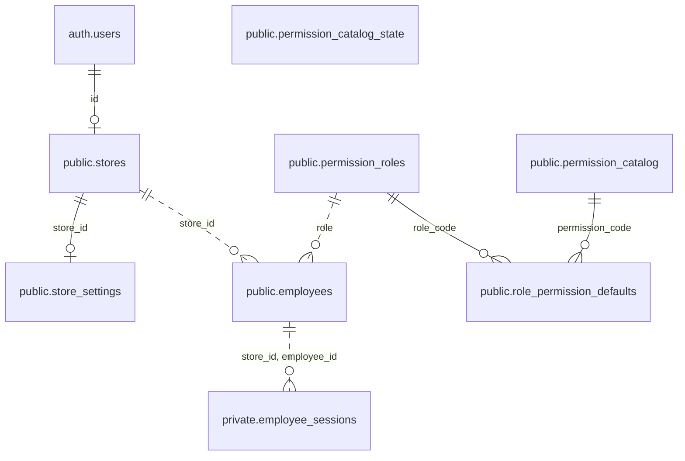
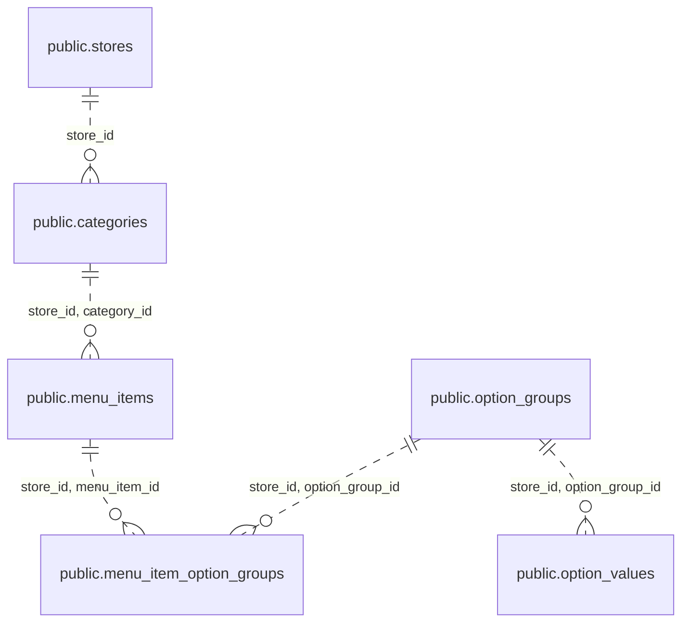
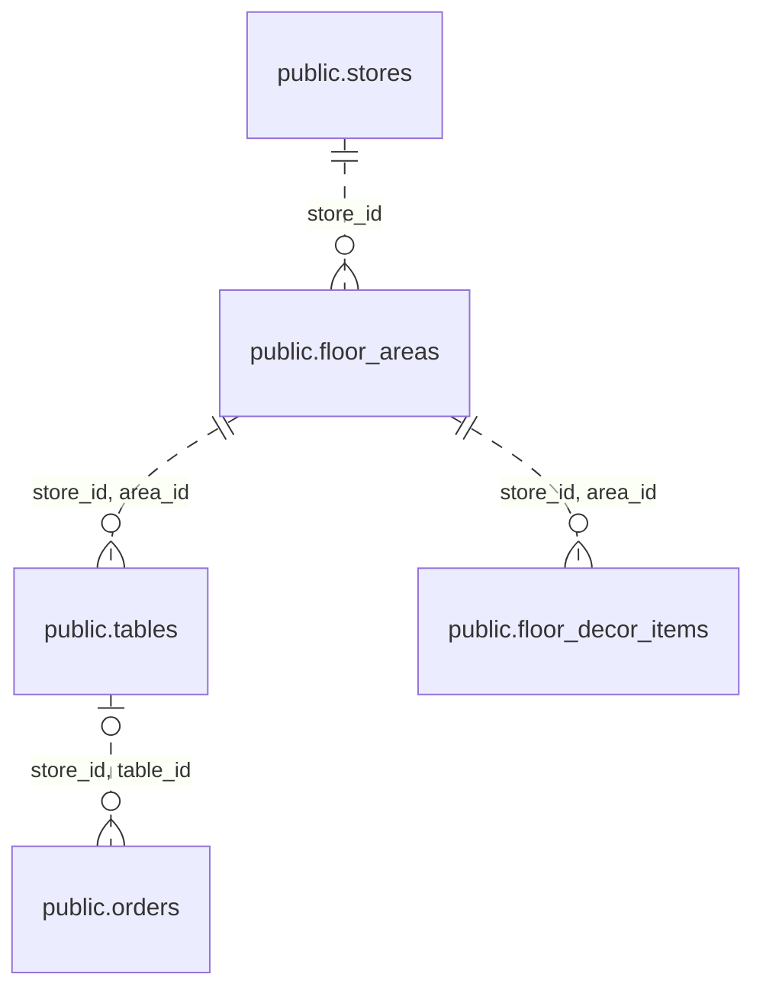
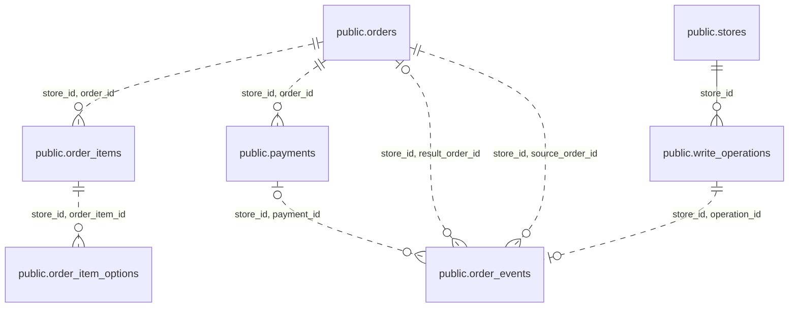
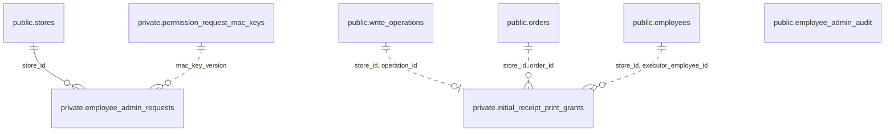
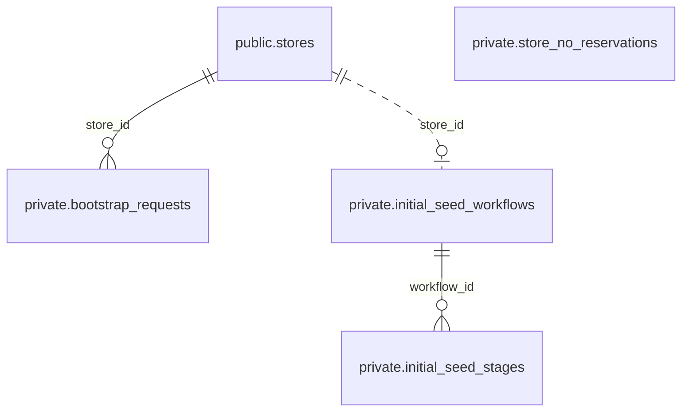
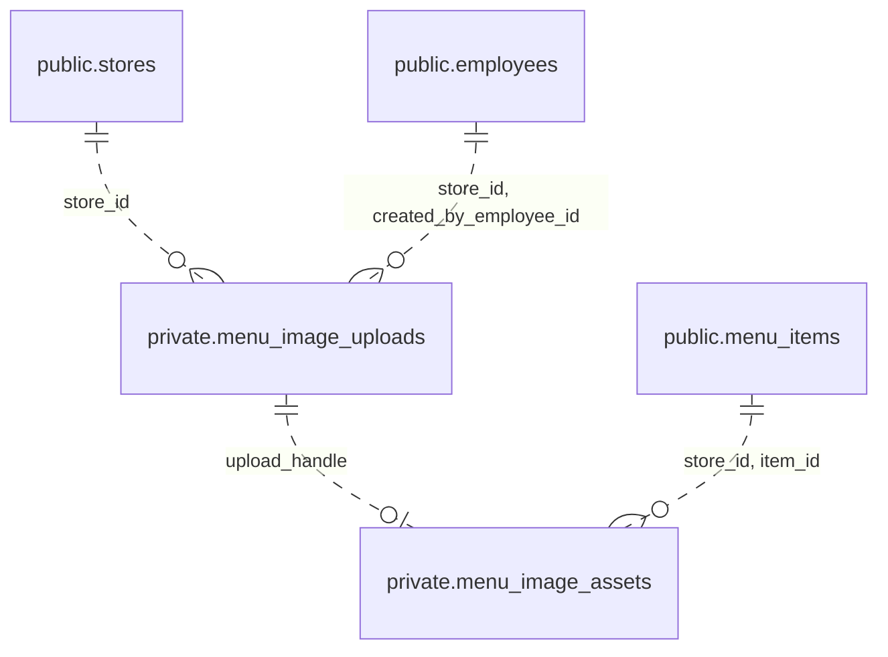
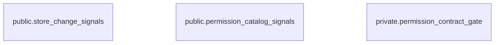

# Data Model

Đối chiếu ngày **26/10/2026**, source `main@711a22e71983e3d6aa17799649af05ce4c762555`. Trang này giữ mô hình, ERD và giải thích nghiệp vụ; [từ điển dữ liệu](data-dictionary.md) giữ chi tiết bảng/cột/ràng buộc; [thuật ngữ](glossary.md) thống nhất cách gọi. Nhánh docs là nguồn viết báo cáo, không là bản báo cáo hoàn chỉnh.

## Phạm vi và cách đọc mô hình

Mô hình gồm nền nghiệp vụ và phần mở rộng quyền/phiên/ledger/registry trong **source candidate**, sau các bước chuyển đổi mà controller mô tả. Ngày26/10/2026 đã [đối chiếu catalog DB staging qua MCP chỉ đọc](implementation-log/staging-schema-20261026/README.md): đủ 35 bảng/332 cột của mô hình; tên/kiểu/NULL, 35 PK, 69 FK (cột hai phía và ON DELETE) và 24 UNIQUE (bộ cột) khớp inventory source. Staging có thêm một bảng marker kỹ thuật riêng, tổng 36 bảng/335 cột. Có schema trên staging không đóng gate nghiệm thu backend đang **HOLD**, không xác nhận production hoặc hành vi runtime.

| Lớp nguồn | Vai trò và cách sử dụng |
| --- | --- |
| Nền migrations 001–016 | Store/menu/floor/order/payment, phiên nhân viên, ledger và audit tài chính; các thay đổi đã loại cột của mô hình partial-payment cũ. |
| Catalog/bridge 017 | Thêm catalog quyền, registry quản trị và bridge legacy; không tự chuyển runtime sang role mới. |
| Preparation + activation candidate | Chuẩn bị contract gate; controller áp 017, đổi employees.role sang text theo mapping được duyệt, áp fragments rồi dọn ba bảng legacy và enum cũ. Đây là mô tả source, không phải lệnh triển khai. |
| Nền tảng và ngoài DB | auth.users và Storage do Supabase quản lý; bytes ảnh, credential client và dữ liệu UI không được cộng thành bảng nghiệp vụ. |

Nguồn: [thứ tự bundle](https://github.com/nguyentronglinh045/pos-cafe/blob/711a22e71983e3d6aa17799649af05ce4c762555/scripts/permission-activation-bundle.mjs#L4), [controller](https://github.com/nguyentronglinh045/pos-cafe/blob/711a22e71983e3d6aa17799649af05ce4c762555/scripts/permission-activation-steps.mjs#L29), [contract gate](https://github.com/nguyentronglinh045/pos-cafe/blob/711a22e71983e3d6aa17799649af05ce4c762555/supabase/candidate/permission-compatibility-prepare.sql#L4). Không lấy thứ tự tên file làm recipe chạy migration; giữ gate và hướng dẫn triển khai ở task backend.

Kiểm kê mô hình source này: **35 bảng dự án, 332 cột**. Ba bảng legacy được controller loại và bảng do nền tảng quản lý không nằm trong số đó. [Chỉ mục từ điển](data-dictionary.md#chỉ-mục-bảng) bao phủ mọi bảng; các ERD dưới là các góc nhìn theo nhóm, không sao chép cùng entity thành nhiều bảng.

> Khi viết báo cáo: trình bày thực thể, quan hệ, kiểu dữ liệu, ràng buộc và lý do thiết kế. Nguồn file/commit/SQL trong docs dùng để kiểm chứng nội bộ theo [source map](report-source-map.md). Mô hình source và schema đã kiểm trên môi trường đích phải ghi riêng.

## ERD Rút Gọn

Các hình là **ERD vật lý rút gọn theo source**, chỉ vẽ FK thật; không vẽ ID audit/tín hiệu thành FK. `||` là đúng một, `|o`/`o|` là không hoặc một, `o{` là không hoặc nhiều. Nét liền dùng khi FK tham gia toàn bộ vào khóa chính của bản ghi con; nét đứt là quan hệ không định danh. Nét đứt vẫn là FK, không có nghĩa “chỉ liên kết logic”. FK ghép ghi đủ tên cột trong nhãn. Xem [cú pháp Mermaid](https://mermaid.js.org/syntax/entityRelationshipDiagram.html#relationship-syntax).

Để hình gọn, một số FK tenant và actor xóa/sửa đã được lược khỏi từng hình; từ điển là nơi liệt kê đầy đủ. Cardinality ở đây lấy từ nullability/PK/UNIQUE; quy tắc thực thi chặt hơn được ghi dưới hình, không suy từ hình rằng sản phẩm đã được kiểm chứng.

### Cửa hàng, nhân viên và danh mục quyền

Nguồn: [001_schema_enums.sql:18](https://github.com/nguyentronglinh045/pos-cafe/blob/711a22e71983e3d6aa17799649af05ce4c762555/supabase/migrations/001_schema_enums.sql#L18), [014_write_identity_and_ledger.sql:162](https://github.com/nguyentronglinh045/pos-cafe/blob/711a22e71983e3d6aa17799649af05ce4c762555/supabase/migrations/014_write_identity_and_ledger.sql#L162), [017_permission_catalog_bridge.sql:4](https://github.com/nguyentronglinh045/pos-cafe/blob/711a22e71983e3d6aa17799649af05ce4c762555/supabase/migrations/017_permission_catalog_bridge.sql#L4), [permission-identity.sql:11](https://github.com/nguyentronglinh045/pos-cafe/blob/711a22e71983e3d6aa17799649af05ce4c762555/supabase/candidate/permission-identity.sql#L11).

Một store có tối đa một settings theo PK/FK. Candidate kiểm đúng một owner hoạt động bằng unique index, CHECK và constraint trigger cuối transaction; FK store–employee riêng lẻ vẫn cho 0..n nhân viên. Vai trò owner ở đây chưa phải tài khoản chủ dùng email thật. Catalog state là singleton độc lập, không có FK từ revision nhân viên/phiên.

### Thực đơn và tùy chọn dùng chung

Nguồn: [001_schema_enums.sql:55](https://github.com/nguyentronglinh045/pos-cafe/blob/711a22e71983e3d6aa17799649af05ce4c762555/supabase/migrations/001_schema_enums.sql#L55), [008_modifier_rework.sql:9](https://github.com/nguyentronglinh045/pos-cafe/blob/711a22e71983e3d6aa17799649af05ce4c762555/supabase/migrations/008_modifier_rework.sql#L9). Nhóm tùy chọn không còn menu_item_id/min_select/max_select. Không có UNIQUE của cặp món–nhóm trong DDL; không diễn giải bảng nối thành ràng buộc duy nhất chưa được khai báo.

### Sơ đồ bàn

Nguồn: [001_schema_enums.sql:126](https://github.com/nguyentronglinh045/pos-cafe/blob/711a22e71983e3d6aa17799649af05ce4c762555/supabase/migrations/001_schema_enums.sql#L126), [002_indexes_rls_triggers.sql:70](https://github.com/nguyentronglinh045/pos-cafe/blob/711a22e71983e3d6aa17799649af05ce4c762555/supabase/migrations/002_indexes_rls_triggers.sql#L70). Order có table_id nullable. Unique index có điều kiện chỉ cho tối đa một đơn open trên mỗi (store, bàn); lịch sử vẫn có nhiều đơn cho cùng bàn. DDL không CHECK cặp order_type–table_id; quy tắc dine-in/takeaway thuộc luồng ghi.

### Đơn, payment, lệnh ghi và event

Nguồn: [001_schema_enums.sql:189](https://github.com/nguyentronglinh045/pos-cafe/blob/711a22e71983e3d6aa17799649af05ce4c762555/supabase/migrations/001_schema_enums.sql#L189), [014_write_identity_and_ledger.sql:330](https://github.com/nguyentronglinh045/pos-cafe/blob/711a22e71983e3d6aa17799649af05ce4c762555/supabase/migrations/014_write_identity_and_ledger.sql#L330).

Schema cho phép nhiều payment/đơn vì không có unique order_id; đường nghiệp vụ hiện tạo tối đa một payment cho một đơn paid. Một lệnh có tối đa một event theo UNIQUE(store_id,operation_id), không phải mọi lệnh đều có event. write_operations.order_id sinh từ payload và không FK tới orders, để đăng ký lệnh tạo đơn trước khi đơn tồn tại. ID nguồn/kết quả trong event mới là các FK thật.

### Quản trị và grant in

Nguồn: [017_permission_catalog_bridge.sql:112](https://github.com/nguyentronglinh045/pos-cafe/blob/711a22e71983e3d6aa17799649af05ce4c762555/supabase/migrations/017_permission_catalog_bridge.sql#L112), [permission-identity.sql:47](https://github.com/nguyentronglinh045/pos-cafe/blob/711a22e71983e3d6aa17799649af05ce4c762555/supabase/candidate/permission-identity.sql#L47), [permission-print.sql:4](https://github.com/nguyentronglinh045/pos-cafe/blob/711a22e71983e3d6aa17799649af05ce4c762555/supabase/candidate/permission-print.sql#L4). Audit quản trị cố ý không có FK nghiệp vụ/nhân viên; registry và audit liên kết bằng khóa logic theo contract. Hash phiên trong grant không có FK tới employee_sessions. Grant nằm ngoài R1, không biến quyền in lại thành quyền mặc định.

### Khởi tạo cửa hàng và dữ liệu mẫu

Nguồn: [017_permission_catalog_bridge.sql:129](https://github.com/nguyentronglinh045/pos-cafe/blob/711a22e71983e3d6aa17799649af05ce4c762555/supabase/migrations/017_permission_catalog_bridge.sql#L129), [permission-identity.sql:67](https://github.com/nguyentronglinh045/pos-cafe/blob/711a22e71983e3d6aa17799649af05ce4c762555/supabase/candidate/permission-identity.sql#L67). Reservation có trước Auth/store nên không có FK tới store. bootstrap_requests.owner_id là ID logic, không FK. Workflow có tối đa một dòng/store; mỗi stage có khóa (workflow_id,stage) và stage_id duy nhất. Đây là seed ban đầu/retry, chưa hòa giải yêu cầu seed lại trong Settings (R06).

### Ảnh món

Nguồn: [permission-images.sql:21](https://github.com/nguyentronglinh045/pos-cafe/blob/711a22e71983e3d6aa17799649af05ce4c762555/supabase/candidate/permission-images.sql#L21). Upload có thể tham chiếu ID món nháp nên item_id chưa FK. Asset công bố có FK món và upload; object_key không FK storage.objects. FK upload_handle riêng lẻ không kiểm store/item của hai registry bằng nhau; function publish kiểm phần đó. Bytes Storage nằm ngoài transaction DB.

### Tín hiệu và cổng tương thích

Nguồn: [permission-identity.sql:56](https://github.com/nguyentronglinh045/pos-cafe/blob/711a22e71983e3d6aa17799649af05ce4c762555/supabase/candidate/permission-identity.sql#L56), [permission-signals.sql:4](https://github.com/nguyentronglinh045/pos-cafe/blob/711a22e71983e3d6aa17799649af05ce4c762555/supabase/candidate/permission-signals.sql#L4), [permission-compatibility-prepare.sql:4](https://github.com/nguyentronglinh045/pos-cafe/blob/711a22e71983e3d6aa17799649af05ce4c762555/supabase/candidate/permission-compatibility-prepare.sql#L4). Ba bảng không có FK. store_id/target_id trong signal là dữ liệu định tuyến logic; revision không tự tạo FK tới catalog. Singleton chỉ có thể có tối đa một dòng theo PK/CHECK; không suy luôn có dòng hoặc strict đã bật ở đích.

### Liên kết logic cần đọc riêng

| Trường/nhóm | Vì sao không vẽ FK |
| --- | --- |
| write_operations.order_id, required_permission | Dữ liệu sinh từ payload/mã quyền; DDL không FK tới order/catalog. |
| employee_admin_audit, actor_key/audit_keys của registry | Snapshot và khóa truy vết, không có FK nghiệp vụ tương ứng. |
| bootstrap_requests.owner_id; số reservation | Tham chiếu theo quy trình bootstrap, không phải FK đã khai báo. |
| uploads.item_id; image_asset_key/object_key | Món nháp hoặc khóa tài nguyên ngoài DB; chỉ asset registry có FK món thật. |
| initial_receipt_print_grants.employee_session_hash | Hash phiên có kiểm ở function, không FK tới bảng phiên. |
| signal target/store/revision; các revision quyền | Tín hiệu/phiên bản để đọc lại, không tự tạo quan hệ tham chiếu. |

Nguồn chi tiết và ràng buộc còn lại ở [từ điển](data-dictionary.md). Không dùng các khoảng thiếu FK trên để tự đề xuất migration hoặc kết luận một lỗi bảo mật đã được tái hiện.

## Quan Hệ Và Ràng Buộc Chính

- Mỗi bảng nghiệp vụ con mang `store_id`; store Auth xác định tenant; đường đọc/ghi runtime mới dùng RPC permission, không suy quyền SELECT trực tiếp từ mô hình legacy.
- `store_settings.store_id` là PK/FK nên mỗi store có tối đa một settings row; create-store flow luôn tạo row này, nhưng schema riêng lẻ vẫn cho phép store có 0 settings.
- `menu_items.category_id` thuộc cùng store; modifier dùng bảng nối nhiều-nhiều `menu_item_option_groups`.
- `tables` và `floor_decor_items` thuộc một `floor_area`; order dine-in có `table_id`, takeaway để `null`.
- `order_items`/`order_item_options` giữ snapshot cả khi đơn còn `open`: retained giữ giá/options, chỉ phần mới lấy giá hiện hành. Đơn `paid`/`void` và receipt giữ lịch sử đã ghi — xem [limitations.md](limitations.md#giá-và-ghi-nhận-doanh-thu) và `015_write_business_helpers.sql`.
- `order_no` unique theo `(store_id, business_date, order_no)`; `lock_version` bảo vệ update cạnh tranh.
- App/RPC hiện tạo tối đa một payment cho một order paid, nhưng schema **không có unique constraint** trên `payments.order_id`; đây là invariant nghiệp vụ, không phải ràng buộc DB tuyệt đối.

## Enum Chính

| Enum | Giá trị | Dùng cho |
| --- | --- | --- |
| Vai trò nhân viên | Catalog `owner`, `manager`, `cashier`, `waiter`, `kitchen` | Candidate chuyển từ enum legacy `admin/cashier/kitchen`; kitchen không bật |
| `seed_status` | `pending`, `seeded`, `failed` | Trạng thái seed dữ liệu mẫu của store |
| `option_select_type` | `single`, `multi` | Cách chọn option/topping |
| `table_shape` | `round`, `square`, `rectangle` | Hình bàn trong floor editor |
| `table_status` | `empty`, `occupied` | Trạng thái vận hành bàn |
| `decor_kind` | `wall`, `plant`, `counter`, `door`, `decor`, `image` | Decor trên sơ đồ |
| `order_type` | `dine_in`, `takeaway` | Loại đơn |
| `order_status` | `open`, `paid`, `void` | Vòng đời order |
| `order_item_status` | `waiting`, `done`, `removed` | Chừa seam cho kitchen/removal |
| `discount_type` | `none`, `percent`, `amount` | Chừa seam discount sau này |
| `payment_method` | `cash`, `bank_transfer`, `qr`, `other` | Phase này UI dùng `cash` |

## Nhóm Store & Settings

`stores` là cửa hàng; `store_settings` giữ tên, địa chỉ, tiền tệ, timezone và footer. `employees` thuộc cửa hàng, giữ PIN hash và trạng thái; candidate dùng role catalog, revision và cờ bắt đổi PIN owner. Store Key ghép thiết bị, không phải bằng chứng sở hữu đủ cho recovery.

| Nhóm quyền/phiên bổ sung | Vai trò |
| --- | --- |
| `permission_roles`, `permission_catalog`, `role_permission_defaults`, `permission_catalog_state` | Vai trò, 15 quyền, defaults và revision catalog |
| `private.employee_sessions` | Token hash, phiên/hạn/thu hồi; không đưa credential vào authority UI |
| `employee_admin_audit`, `private.employee_admin_requests` | Audit quản trị và registry chống thực hiện lặp |
| `store_change_signals`, `permission_catalog_signals` | Tín hiệu tối thiểu để invalidate/refresh |
| `private.initial_seed_workflows`, `private.initial_seed_stages` | Tiến độ seed theo stage, retry có kiểm soát |

Nguồn: [017:4](https://github.com/nguyentronglinh045/pos-cafe/blob/711a22e71983e3d6aa17799649af05ce4c762555/supabase/migrations/017_permission_catalog_bridge.sql#L4), [identity:13](https://github.com/nguyentronglinh045/pos-cafe/blob/711a22e71983e3d6aa17799649af05ce4c762555/supabase/candidate/permission-identity.sql#L13), [identity:47](https://github.com/nguyentronglinh045/pos-cafe/blob/711a22e71983e3d6aa17799649af05ce4c762555/supabase/candidate/permission-identity.sql#L47). Các ERD ở trên đã bổ sung catalog/quyền/audit; từ điển giữ chi tiết ràng buộc. Không áp SQL candidate như migration tự động chỉ vì file nằm trên main.

## Nhóm Menu

- `categories`: danh mục món.
- `menu_items`: món, giá, category, availability, image asset key.
- `option_groups`: nhóm tuỳ chọn (modifier) **dùng chung cho mọi món** — `select_type` single/multi + `is_required`. Không gắn cứng vào một món (đã bỏ `menu_item_id`, `min_select`, `max_select`).
- `option_values`: giá trị tuỳ chọn và `price_delta` (giá của modifier, có thể 0).
- `menu_item_option_groups`: bảng nối nhiều-nhiều cho biết **món nào dùng nhóm nào** (`menu_item_id` × `option_group_id`, `sort_order`). Cũng xóa mềm như các bảng menu khác.

Ý nghĩa:

- Modifier là thư viện dùng chung: quản lý nhóm/giá trị ở một nơi, gắn vào nhiều món bằng cách tick (tạo/xoá link). Sửa một nhóm ảnh hưởng mọi món đang dùng.
- Nhóm `single` cho chọn tối đa 1 giá trị; `multi` cho chọn nhiều giá trị, mỗi giá trị có số lượng riêng (xem `order_item_options.quantity`). Nhóm `is_required` bắt buộc chọn ≥ 1.
- Menu editor lưu thay đổi bằng changeset (gồm cả changeset cho `menu_item_option_groups`).
- Các bảng menu dùng xóa mềm để giữ đường mở rộng sync/offline.
- Với phần mới, server kiểm quote từng thành phần theo catalog hiện hành và snapshot tên/giá; khác quote thì PRICE_CHANGED trước khi ghi, không tự chấp nhận giá mới. Tuỳ chọn mới phải thuộc nhóm liên kết đúng món. Phần retained giữ snapshot cũ và source ID, không bị định giá lại theo catalog. Nguồn: `015_write_business_helpers.sql`, `src/features/pos/orderFlow.ts:73` và `:234`.

## Nhóm Floor

- `floor_areas`: khu/tầng.
- `tables`: bàn, vị trí, kích thước, shape, seats, status và `background_asset_key` nullable.
- `floor_decor_items`: decor trên sơ đồ, asset key, vị trí, z-index, lock.

Ý nghĩa:

- Floor editor chỉ chỉnh layout, không ghi đè `table.status`.
- `table.status` do order/payment flow cập nhật.
- `tables.background_asset_key` lưu public path của một trong 11 ảnh nền bàn built-in. `null` là contract nền trắng mặc định cho bàn cũ và bàn mới.
- Catalog/resolver chỉ render key thuộc bộ asset đóng gói; key lạ hoặc thiếu fallback về nền trắng. Trạng thái bàn vẫn thể hiện bằng border, không được mã hóa vào ảnh nền.
- Decor không nhận order và không xuất hiện trong nghiệp vụ bàn.
- `floor_decor_items.asset_key` lưu đường dẫn asset built-in của ứng dụng. Catalog hiện có 9 texture tường và 131 PNG trang trí; thay catalog không cần đổi schema.
- Asset key legacy/không còn trong catalog vẫn được client render bằng placeholder nhãn/màu, tránh làm hỏng floor plan cũ.

## Nhóm Order

- `orders`: order number theo business date, loại order, table nullable, subtotal/discount/total, status, employee, lock version, và metadata hủy (`voided_at`, `voided_by_employee_id`, `void_reason_code`, `void_reason_note`).
- `order_items`: snapshot item name, quantity, unit price, note, status.
- `order_item_options`: snapshot option name, price delta và **`quantity`** (số lượng modifier; nhóm single luôn 1, nhóm multi cho >1).

Ý nghĩa:

- `business_date` lấy theo timezone của store, không theo timezone máy.
- `order_no` unique theo `(store_id, business_date, order_no)`.
- `lock_version` dùng để phát hiện stale/conflict khi nhiều máy cùng thao tác (tách đơn instant pay cũng bump version đơn gốc).
- Update khai rõ retainedLines và newLines. Dòng retained giữ ID, unit_price và options; giảm số lượng/sửa note giữ giá; xóa giữ raw quantity/options và mark removed. Tăng phần cũ tạo dòng mới theo giá/cấu hình hiện tại. Thiếu, trùng hoặc giả source ID bị từ chối, không tìm dòng bằng tên/giá để đoán.
- `business_date` chốt lúc tạo đơn và không đổi khi sửa; đơn mở qua ngày vẫn thuộc business date cũ.
- Hủy đơn mở: khi giỏ của đơn đã có không còn dòng có số lượng dương, flow gửi `kind: submit_order_changes`, `action: void_open`. DB đánh dấu các dòng là `removed`, giữ raw quantity/options, đặt subtotal/total về 0, đổi đơn sang `void`, tăng version và trả bàn; paid_at của đơn chưa thu tiền vẫn null. Nguồn: [orderFlow.ts:261](https://github.com/nguyentronglinh045/pos-cafe/blob/711a22e71983e3d6aa17799649af05ce4c762555/src/features/pos/orderFlow.ts#L261), [015_write_business_helpers.sql:254](https://github.com/nguyentronglinh045/pos-cafe/blob/711a22e71983e3d6aa17799649af05ce4c762555/supabase/migrations/015_write_business_helpers.sql#L254).
- Hủy đơn đã thanh toán: giao thức v1 dùng `kind: void_order`, không có `action: void_paid`. DB giữ total/subtotal/order_no/business_date/paid_at và payment row, đổi status sang `void`, ghi metadata hủy và tăng lock_version, không đổi bàn. paid_at khác null phân biệt với hủy trước thanh toán. Nguồn: [writeOperations.ts:13](https://github.com/nguyentronglinh045/pos-cafe/blob/711a22e71983e3d6aa17799649af05ce4c762555/src/domain/writeOperations.ts#L13), [015_write_business_helpers.sql:273](https://github.com/nguyentronglinh045/pos-cafe/blob/711a22e71983e3d6aa17799649af05ce4c762555/supabase/migrations/015_write_business_helpers.sql#L273).

## Nhóm Payment & Report

- `payments`: payment theo order, employee, method, amount, received amount, change amount, paid_at. Flow RPC hiện hành tạo một payment cho mỗi đơn paid; DML client bị thu hồi; schema không thêm unique trên `order_id` trong release này.
- Report không có bảng riêng trong MVP; report query tính từ order/payment đã thanh toán.

Ý nghĩa:

- Phase này payment UI dùng cash-only.
- **Instant pay (split-order)**: thanh toán một phần = tách các món được chọn ra một **đơn mới độc lập** và thanh toán đơn đó ngay trong cùng transaction. Hai đơn độc lập về nghiệp vụ, cùng nhãn bàn; ledger và event v1 giữ ID nguồn/kết quả để truy vết lần tách. Đơn gốc còn lại trên bàn là đơn mở bình thường; bàn chỉ trống khi phần còn lại được thanh toán.
- **Quy tắc đánh số**: bill trả trước mang `order_no` nhỏ hơn — đơn tách kế thừa số của đơn gốc, đơn gốc nhận số mới (max+1 theo `business_date`). Bàn #12 trả 2 lần → bill #12, phần còn lại thành #13, bill #13. **Lưu ý khi đối chiếu UI:** từ `main@c7f2f4e`, màn Lịch sử đơn không hiển thị `order_no` mà hiển thị số thứ tự theo bộ lọc; `order_no` thật chỉ còn thấy trên hóa đơn in.
- Trả một phần số lượng của một dòng (vd 1 trong 2 Cà phê sữa) → tách dòng: dòng mới (UUID client cấp qua `splitItemId`) thuộc **đơn tách**; dòng gốc giảm quantity. Options của dòng tách là snapshot copy (id server cấp).
- Report tính order `paid` theo `business_date` — **mỗi lần thu vào report NGAY** vì đơn tách paid tức thì (không có trạng thái "tiền đã thu nhưng chưa ghi nhận"). Không có bảng tổng hợp lưu sẵn nên khi một đơn chuyển `paid → void`, doanh thu ngày/tháng tự loại đơn đó ra (không cần bút toán điều chỉnh).
- `CoreReport` bổ sung `voidCount`/`voidAmount` = số đơn và tổng tiền của các đơn **paid-rồi-hủy** (`status='void'` và `paid_at is not null`) theo `business_date`; đơn open-bị-hủy (`paid_at` null, `total` 0) không tính vào đây.
- Order history là order-centric: mỗi bill (đơn tách hoặc đơn thường) một dòng, không có màn tổng hợp cả phiên bàn; liên kết thao tác nằm ở ledger/audit. Đơn `void` hiển thị trong history (filter "Đã hủy") kèm người hủy/thời điểm/lý do.

## Ledger, phiên và audit v1

| Bảng / trường mới | Vai trò |
| --- | --- |
| `private.employee_sessions` | Hash token, store/employee, thời điểm cấp, hạn và thu hồi; client không đọc trực tiếp. |
| `write_operations` | Khóa chính (store_id, operation_id), payload bất biến, kind/action, quyền cần, pending/applied/rejected/cancelled/expired, R1, actor và replay count. |
| `order_events` | Liên kết K với đơn nguồn/kết quả/payment, người khởi tạo/thực hiện và version trước/sau; chỉ ghi cùng transaction thành công. |
| `orders.created_by_employee_id`, `last_modified_by_employee_id` | Tách người tạo khỏi người sửa; legacy không rõ creator để null. |
| `payments.receipt_snapshot` | Receipt tài chính và metadata tại thời điểm thanh toán; in lại không lấy tên/giá menu mới. |

Nguồn: `014_write_identity_and_ledger.sql:162`, `:322`, `:330`, `:355`. Ledger/R1/audit không có GC trong release này; clear demo giữ nguyên tài chính và lịch sử, chỉ tombstone dữ liệu mẫu phù hợp.

## RPC Chính

Runtime đọc qua các projections theo purpose và ghi qua permission changes/admin hoặc giao thức v1. Xem [hợp đồng read/session/admin](https://github.com/nguyentronglinh045/pos-cafe/blob/711a22e71983e3d6aa17799649af05ce4c762555/src/ports/permissions.ts#L12), [write contract:71](https://github.com/nguyentronglinh045/pos-cafe/blob/711a22e71983e3d6aa17799649af05ce4c762555/src/ports/index.ts#L71). Register/execute/get/list/cancel và receipt là các trách nhiệm riêng; không dùng raw table/DML hoặc overload cũ làm fallback.

SQL identity, administration, financial, read, changes, images, print, signals, seed và compatibility có trong `supabase/candidate/`. Đây là gói triển khai có gate riêng, không phải bằng chứng hosted đã activate. Các bảng/DTO legacy còn phục vụ regression và chuyển đổi.

## Domain Types Trong App

- `MenuCatalog`: categories, menuItems, optionGroups, optionValues, menuItemOptionGroups.
- `FloorPlan`: areas, tables, decorItems.
- `OrderSummary`/`OrderDetail`: order state, total, table/order type, snapshot items; `OrderDetail.payment` giữ payment snapshot nullable cho đơn đã thanh toán; `OrderDetail` còn có metadata hủy (`voidedAt`, `voidedByEmployeeId`, `voidReasonCode`, `voidReasonNote`).
- `VoidOrderInput`/`VoidOrderResult`: hủy đơn đã thanh toán (`reasonCode: VoidReasonCode`, `reasonNote`, `expectedVersion`). `EmployeePermission`/`EmployeePermissionOverrides` là kiểu legacy; runtime mới dùng `PermissionCatalog`, `AuthorityBundle`, `PermissionEmployee` trong `src/domain/permissions.ts:1`.
- `PayOrderInput`/`PayOrderResult`: payment cash flow và receipt payload.
- `PayOrderItemsInput`/`PayOrderItemsResult`: instant pay tách đơn (`newOrderId` + `items: {orderItemId, quantity, splitItemId}`), kết quả gồm đơn tách đã paid + trạng thái đơn gốc còn lại.
- `MenuChanges`/`FloorPlanChanges`: changeset create/update/delete cho editor.

## Menu Image Storage

Runtime mới stage ảnh qua `menu-image-gateway`, dùng upload handle và finalization được kiểm quyền. Metadata private tách upload và published asset; GET phục vụ ảnh ở `menu-image-public`. Không mô tả public bucket + ghi trực tiếp theo thư mục của adapter legacy là contract runtime mới.

Nguồn: [permissionMenuImagePort.ts:49](https://github.com/nguyentronglinh045/pos-cafe/blob/711a22e71983e3d6aa17799649af05ce4c762555/src/adapters/supabase/permissionMenuImagePort.ts#L49), [permission-images.sql:21](https://github.com/nguyentronglinh045/pos-cafe/blob/711a22e71983e3d6aa17799649af05ce4c762555/supabase/candidate/permission-images.sql#L21), [public handler](https://github.com/nguyentronglinh045/pos-cafe/blob/711a22e71983e3d6aa17799649af05ce4c762555/supabase/functions/menu-image-public/index.ts#L1). DB và Storage không chung transaction; orphan cleanup, service profiles và nghiệm thu còn đọc theo gate backend, không suy từ mock UI.

## Quyền in hóa đơn

`private.initial_receipt_print_grants` giữ eligibility cho preview initial, riêng với K/R1 bất biến. In lại dùng `receipt.reprint`; quyền đọc và quyền in không đồng nhất. [permission-print.sql:4](https://github.com/nguyentronglinh045/pos-cafe/blob/711a22e71983e3d6aa17799649af05ce4c762555/supabase/candidate/permission-print.sql#L4).

## Phạm vi nguồn

Chi tiết nghiệp vụ menu/floor/order/payment ở trên kế thừa quyết định đã chốt và được đối chiếu với [domain models](https://github.com/nguyentronglinh045/pos-cafe/blob/711a22e71983e3d6aa17799649af05ce4c762555/src/domain/models.ts#L1), [financial candidate](https://github.com/nguyentronglinh045/pos-cafe/blob/711a22e71983e3d6aa17799649af05ce4c762555/supabase/candidate/permission-financial.sql#L1). Những nguồn phase 27 ghi trong từng mục là provenance lịch sử, không xác nhận deployment hiện hành.
